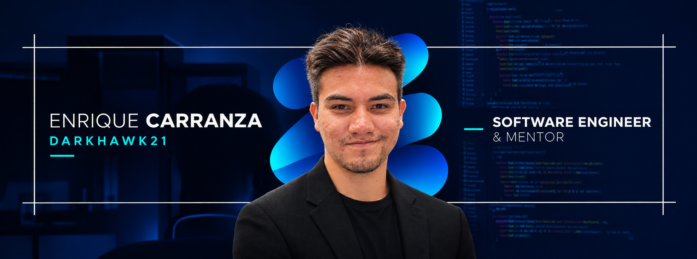

# Software Architect & Tech Lead

Conversational AI · Digital Transformation · Senior Full Stack Engineer

## Sobre mí

Ingeniero en Computación con más de 7 años de experiencia diseñando, desarrollando y liderando soluciones de software escalables para empresas y plataformas de alto impacto.

He participado en la construcción de sistemas empresariales, automatizaciones, integraciones, bots conversacionales con IA y arquitecturas backend/frontend capaces de procesar grandes volúmenes de información y soportar operaciones críticas.

Me especializo en arquitectura de software, automatización de procesos, inteligencia artificial conversacional y transformación digital, colaborando tanto en la toma de decisiones técnicas como en la definición de estrategias orientadas a negocio.

Lidero equipos, coordino proyectos, participo en la definición de arquitectura y colaboro directamente con stakeholders, áreas de negocio y dirección para transformar necesidades operativas en soluciones tecnológicas reales y escalables.

---

## Stack tecnológico

### Lenguajes de programación

### Desarrollo Frontend

### Desarrollo Backend

### Bases de datos

### Cloud, DevOps y herramientas

---

### Principios que guían mi trabajo

- **Simplicidad antes que complejidad innecesaria.**
- **Mantenibilidad antes que soluciones temporales.**
- **Escalabilidad basada en necesidades reales.**
- **Seguridad y confiabilidad desde el diseño.**
- **Decisiones técnicas alineadas con los objetivos del negocio.**
- **Mejora continua mediante colaboración y transferencia de conocimiento.**

---

### Actividad en GitHub

